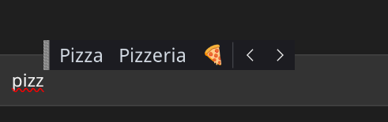

# Wortvorhersage

[English](README.md) · **Deutsch**



Textvorschläge beim Tippen auf der normalen Tastatur, wie die „Textvorschläge für Hardwaretastatur“ von Windows – als IBus-Engine für Linux (getestet mit KDE Plasma 6 unter Wayland).

- Getippter Text geht sofort in die App, darüber erscheint eine Leiste mit Vorschlägen.
- Deutsch und Englisch gleichzeitig; die Sprache, in der du gerade schreibst, rutscht automatisch nach vorn.
- Nach einem Leerzeichen wird schon das nächste Wort vorgeschlagen („ich“ → „habe“, „bin“, …).
- Emojis als letzter Vorschlag („Pizza“ → 🍕, „Herz“ → ♥️).
- Lernt, was du tippst (nie in Passwortfeldern), und bevorzugt deine eigenen Wörter.
- Menü, Einstellungsdatei und Installationsskript auf Deutsch oder Englisch, je nach Systemsprache.

## Bedienung

Zwei Modi, umschaltbar im IBus-Menü (Symbol in der Systemleiste) oder in der Einstellungsdatei. Es ist immer nur einer aktiv.

| Modus | Vorschlag wählen | Übernehmen | Schließen |
|---|---|---|---|
| **windows** | ↑ springt in die Leiste, ← → wählt | Enter oder Leertaste | Esc, ↓ |
| **tab** | – | Tab = erster Vorschlag, Alt+2 / Alt+3 … = weitere | Esc |
| **aus** | keine Vorschläge | | |

Nach dem Übernehmen kommt ein Leerzeichen dazu. Tippst du direkt danach ein Satzzeichen, rückt es ans Wort („Hallo ,“ → „Hallo,“).

Im Windows-Modus fängt ↑ die Taste ab, solange die Leiste sichtbar ist – genau wie unter Windows. In Terminals, wo du ↑ für den Verlauf brauchst, ist der Tab-Modus angenehmer.

## Installation

```bash
./install.sh
```

Das Skript
1. legt die Komponenten-Datei nach `/usr/share/ibus/component/` (fragt nach sudo),
2. trägt die Wortvorhersage als erste IBus-Eingabemethode ein,
3. setzt in KWin „IBus Wayland“ als virtuelle Tastatur (Systemeinstellungen → Tastatur → Virtuelle Tastatur),
4. installiert das KWin-Skript, das die Leiste über den Text schiebt.

Danach einmal ab- und wieder anmelden. Die Engine läuft aus diesem Ordner; wenn du ihn verschiebst, `./install.sh` noch einmal ausführen.

Entfernen: `./uninstall.sh`

### Apps, die extra Einstellungen brauchen

- **Chrome, Chromium, Electron-Apps (VS Code, Discord …)**: mit `--enable-wayland-ime` starten.
- **XWayland-Apps** laufen über XIM, das IBus Wayland mitstartet; sie brauchen evtl. `XMODIFIERS=@im=ibus` in der Umgebung.
- KDE-, GTK- und Firefox-Fenster funktionieren direkt.

## Dateien

| Was | Wo |
|---|---|
| Einstellungen | `~/.config/wortvorhersage/einstellungen.ini` (Änderungen gelten beim nächsten Fokuswechsel) |
| Eigene Wörter | `~/.config/wortvorhersage/eigene_woerter.txt`, ein Wort pro Zeile |
| Gelerntes | `~/.local/share/wortvorhersage/gelernt.sqlite` (löschen = alles vergessen) |
| Log | `~/.cache/wortvorhersage.log` |

Eigene Wörter kannst du auch über das IBus-Menü hinzufügen („… zu eigenen Wörtern“ nimmt das zuletzt getippte Wort) oder die Datei von dort aus öffnen.

Die Leiste selbst zeichnet IBus. Ihre Schriftgröße stellst du so ein:

```bash
gsettings set org.freedesktop.ibus.panel custom-font 'Noto Sans 14'
gsettings set org.freedesktop.ibus.panel use-custom-font true
```

Wo die Leiste erscheint, entscheidet eigentlich KWin: unter dem Cursor, nur wenn unten kein Platz ist, darüber. Damit sie wie unter Windows über dem Text steht, installiert `install.sh` das KWin-Skript `kwin-skript/` („Wortvorhersage oben“), das sie jedes Mal nach oben schiebt. KWin verrät Skripten die Höhe der Textzeile nicht, deshalb schätzt es sie auf 22 Pixel. Steht die Leiste zu dicht am Text oder zu weit weg:

```bash
kwriteconfig6 --file kwinrc --group Script-wortvorhersage-oben --key Zeilenhoehe 26
qdbus6 org.kde.KWin /Scripting org.kde.kwin.Scripting.unloadScript wortvorhersage-oben
qdbus6 org.kde.KWin /KWin reconfigure
```

Abschalten unter Systemeinstellungen → Fensterverwaltung → KWin-Skripte. Steht der Cursor ganz unten am Bildschirmrand, hat KWin die Leiste schon selbst hochgesetzt; dann landet sie etwas zu hoch.

Die Einstellungsdatei erklärt jede Option selbst. Die wichtigsten: `modus`, `anzahl` (Vorschläge in der Leiste), `emojis`, `emoji_ersetzt_wort`, `naechstes_wort`, `lernen`, `sprachen`. Die englischen Namen (`mode`, `count`, …) gehen genauso.

## Aufbau

```
ibus-engine-wortvorhersage   Startskript, das IBus aufruft
wortvorhersage/
  dienst.py                  Anmeldung bei IBus, gemeinsame Daten für alle Fenster
  engine.py                  Tastenverarbeitung, Leiste, Übernehmen, Menü
  vorhersage.py              Bewertung der Vorschläge (Wörterbuch, Wortpaare, Gelerntes, Emojis)
  lernspeicher.py            SQLite-Speicher für gelernte Wörter und Wortpaare
  einstellungen.py           INI-Datei und eigene Wörter
  texte.py                   alle sichtbaren Texte auf Deutsch und Englisch
daten/                       fertige Wörterbücher (aus werkzeuge/daten_holen.sh)
werkzeuge/
  daten_holen.sh             lädt die Korpora und baut daten/ neu
  woerterbuch_bauen.py       Korpus → Wortliste, Wortpaare, Emoji-Stichwörter
kwin-skript/                 KWin-Skript, das die Leiste über den Textcursor schiebt
tests/ibus_probe.py          Probelauf gegen einen eigenen, abgeschotteten ibus-daemon
```

Beim Übernehmen fügt die Engine nur den fehlenden Rest ein („Ich gla“ + „glaube“ → „ube “). Nur wenn sich die Schreibweise ändert („ha“ → „Haus“) oder ein Emoji das Wort ersetzt, löscht sie vorher zurück: über den umgebenden Text, wenn die App ihn meldet, sonst mit Rücktasten.

## Testen

```bash
python3 tests/ibus_probe.py
```

Startet einen privaten ibus-daemon (dein normales IBus bleibt unberührt), tippt Tastenfolgen in ein simuliertes Textfeld und prüft beide Modi, Lernen, eigene Wörter, Emojis und Passwortfelder.

## Datenquellen

- Wortlisten und Wortpaare: [Leipzig Corpora Collection](https://wortschatz.uni-leipzig.de/de/download), Korpora `deu_news_2023_300K` und `eng_news_2023_300K`, Universität Leipzig, angeboten unter [CC BY](https://wortschatz.uni-leipzig.de/de/usage).
- Emoji-Namen: Unicode CLDR (aus `ibus-typing-booster`, [Unicode License](https://www.unicode.org/license.txt)), Emoji-Liste aus `/usr/share/unicode/emoji`.

## Lizenz

Code: MIT, siehe [LICENSE](LICENSE). Die Daten in `daten/` behalten die Lizenzen ihrer oben genannten Quellen.
