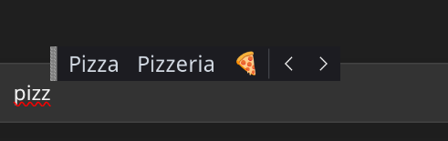

# Wortvorhersage – word prediction for Linux

**English** · [Deutsch](README.de.md)



Text suggestions while typing on a physical keyboard, like Windows' "text suggestions for hardware keyboard", as an IBus engine for Linux (tested on KDE Plasma 6 with Wayland).

- What you type goes straight into the app, and a bar with suggestions appears above it.
- English and German at the same time; the language you are currently writing in moves to the front automatically.
- Right after a space it already suggests the next word ("I" → "think", "was", "am", …).
- Emoji as the last suggestion ("pizza" → 🍕, "heart" → 💖).
- Learns what you type (never in password fields) and prefers your own words.
- Menu, settings file and install script in English or German, depending on your system language.

## Usage

Two modes, switchable in the IBus menu (tray icon) or in the settings file. Only one is active at a time.

| Mode | Choose | Accept | Close |
|---|---|---|---|
| **windows** | ↑ enters the bar, ← → chooses | Enter or Space | Esc, ↓ |
| **tab** | – | Tab = first suggestion, Alt+2 / Alt+3 … = others | Esc |
| **off** | no suggestions | | |

Accepting a suggestion adds a space. If you type punctuation right after it, it moves up to the word ("Hello ," → "Hello,").

In Windows mode, ↑ is taken over while the bar is visible, exactly like on Windows. In terminals, where you need ↑ for history, Tab mode is more comfortable.

## Installation

Requirements: IBus with Python bindings (`ibus`, `python3-ibus-1.0`, `gir1.2-ibus-1.0`), KDE Plasma 6 on Wayland.

```bash
./install.sh
```

The script
1. puts the component file into `/usr/share/ibus/component/` (asks for sudo),
2. makes word prediction the first IBus input method (your keyboard layout stays second),
3. sets "IBus Wayland" as KWin's virtual keyboard (System Settings → Keyboard → Virtual Keyboard),
4. installs the KWin script that moves the bar above the text.

Then log out and back in once. The engine runs from this folder; if you move it, run `./install.sh` again.

Remove: `./uninstall.sh`

### Apps that need extra setup

- **Chrome, Chromium, Electron apps (VS Code, Discord …)**: start with `--enable-wayland-ime`.
- **XWayland apps** use XIM, which IBus Wayland starts as well; they may need `XMODIFIERS=@im=ibus` in their environment.
- KDE, GTK and Firefox windows work right away.

## Files

| What | Where |
|---|---|
| Settings | `~/.config/wortvorhersage/einstellungen.ini` (changes apply on the next focus change) |
| Your words | `~/.config/wortvorhersage/eigene_woerter.txt`, one word per line |
| Learned words | `~/.local/share/wortvorhersage/gelernt.sqlite` (delete it to forget everything) |
| Log | `~/.cache/wortvorhersage.log` |

You can also add words from the IBus menu ("Add … to my words" takes the last word you typed) or open the file from there.

The settings file explains every option. The most important: `mode`, `languages` (e.g. `en, de`; the first one is preferred at the start), `count`, `emojis`, `emoji_replaces_word`, `next_word`, `learn`. German key names work too.

The bar itself is drawn by IBus. To change its font size:

```bash
gsettings set org.freedesktop.ibus.panel custom-font 'Noto Sans 14'
gsettings set org.freedesktop.ibus.panel use-custom-font true
```

Where the bar appears is decided by KWin: below the cursor, and above only if there is no room below. To put it above the text like on Windows, `install.sh` installs the KWin script in `kwin-skript/` ("Word Prediction Above"), which moves it up every time. KWin does not tell scripts the height of the text line, so it assumes 22 pixels. If the bar is too close to the text or too far away:

```bash
kwriteconfig6 --file kwinrc --group Script-wortvorhersage-oben --key Zeilenhoehe 26
qdbus6 org.kde.KWin /Scripting org.kde.kwin.Scripting.unloadScript wortvorhersage-oben
qdbus6 org.kde.KWin /KWin reconfigure
```

Turn it off under System Settings → Window Management → KWin Scripts. If the cursor is right at the bottom edge of the screen, KWin has already placed the bar above, and it ends up a little too high.

## How it works

The code uses German names throughout. A short map:

```
ibus-engine-wortvorhersage   launcher that IBus runs
wortvorhersage/
  dienst.py                  IBus registration, data shared by all windows
  engine.py                  key handling, suggestion bar, accepting, menu
  vorhersage.py              ranking suggestions (dictionary, word pairs, learned words, emoji)
  lernspeicher.py            SQLite store for learned words and word pairs
  einstellungen.py           settings file and your own words
  texte.py                   all visible texts in German and English
daten/                       ready-made dictionaries (built by werkzeuge/daten_holen.sh)
werkzeuge/
  daten_holen.sh             downloads the corpora and rebuilds daten/
  woerterbuch_bauen.py       corpus → word list, word pairs, emoji keywords
kwin-skript/                 KWin script that moves the bar above the text cursor
tests/ibus_probe.py          test run against a private, isolated ibus-daemon
```

When you accept a suggestion, the engine only inserts the missing rest ("I bel" + "believe" → "ieve "). Only when the spelling changes ("ha" → "Haus") or an emoji replaces the word does it delete first: via the surrounding text if the app reports it, otherwise with backspaces.

## Testing

```bash
python3 tests/ibus_probe.py
```

Starts a private ibus-daemon (your normal IBus is untouched), types key sequences into a simulated text field and checks both modes, learning, your own words, emoji, the menu and password fields.

## Data sources

- Word lists and word pairs: [Leipzig Corpora Collection](https://wortschatz.uni-leipzig.de/en/download), corpora `deu_news_2023_300K` and `eng_news_2023_300K`, Leipzig University, offered under [CC BY](https://wortschatz.uni-leipzig.de/en/usage).
- Emoji names: Unicode CLDR (from `ibus-typing-booster`, [Unicode License](https://www.unicode.org/license.txt)), emoji list from `/usr/share/unicode/emoji`.

## License

Code: MIT, see [LICENSE](LICENSE). The data in `daten/` keeps the licenses of its sources listed above.
